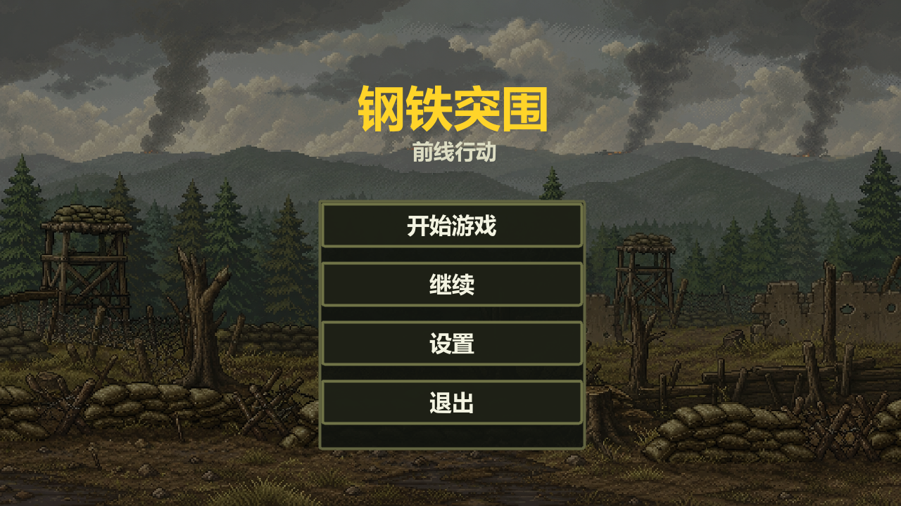
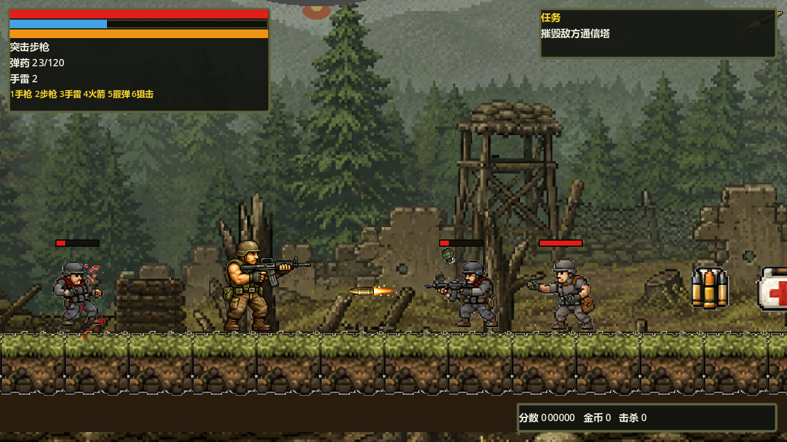
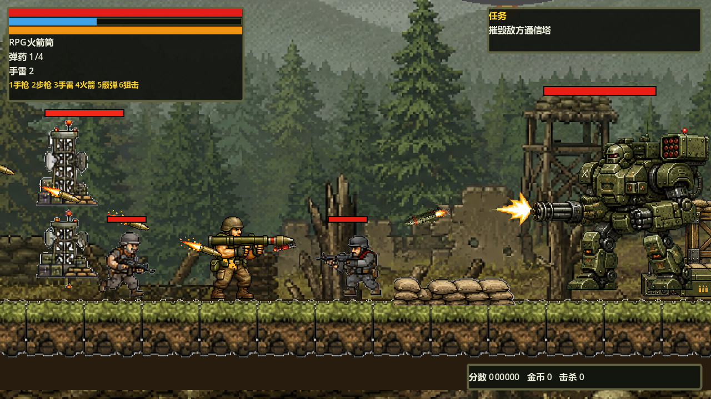
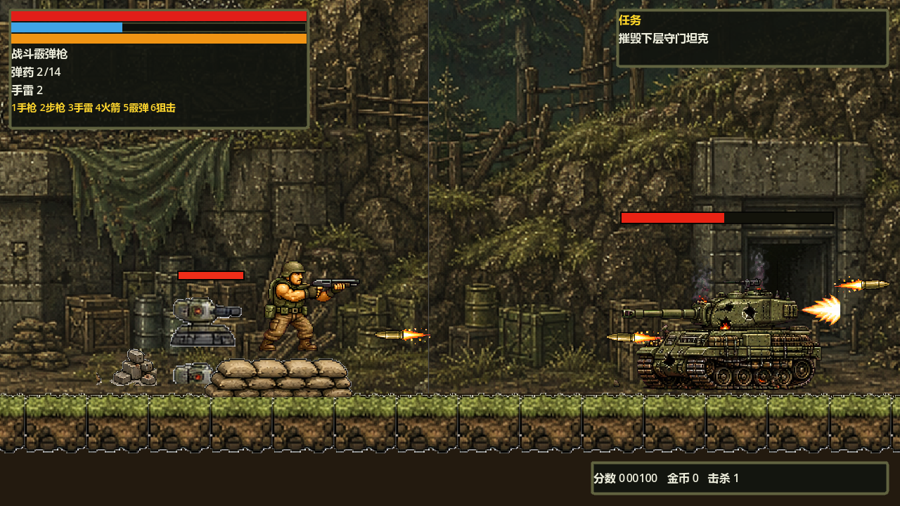

<div align="center">

# 钢铁突围：前线行动
### Steel Breakout: Frontline Action

**穿过森林防线，迎战重装机甲，突入装甲堡垒。**

Godot 4.6 · 像素横版射击 · 单人双关卡 · Windows x64

[下载 Windows 试玩版](https://github.com/xingyuliu586-tech/steel-breakout-frontline/releases/tag/v0.1.0) · [操作说明](#操作说明) · [开发与构建](#开发与构建) · [反馈问题](https://github.com/xingyuliu586-tech/steel-breakout-frontline/issues)



</div>

## 作品介绍

这是 October 的第一款游戏，一款仍在迭代的军事题材像素横版射击作品。使用鼠标瞄准，在步兵、炮塔和装甲单位的交叉火力中推进，沿途拾取补给与重武器，完成目标后撤离。

**v0.1.0 是可玩的开发试玩版，不是最终完成版。** 当前提供两个连续关卡，没有联网或内购功能。世界观与人物均为虚构；本项目并非《合金弹头》或《Counter-Strike》的官方作品。

## 直接开始

1. 打开 [v0.1.0 发布页](https://github.com/xingyuliu586-tech/steel-breakout-frontline/releases/tag/v0.1.0)。
2. 下载 **SteelBreakout-v0.1.0-Windows-x64.zip**，完整解压。
3. 双击 **SteelBreakout.exe**，点击“开始游戏”。不需要安装 Godot。

请保持 `SteelBreakout.exe` 与 `SteelBreakout.pck` 在同一目录，不要只复制其中一个。源码 ZIP 供开发使用，不是可直接运行的游戏包。

目标平台是 Windows 10/11 64 位，键盘与鼠标操作，显卡需支持 OpenGL 3.3。当前使用兼容性渲染模式；尚未完成不同硬件上的兼容性测试。发布文件未进行商业代码签名，Windows 可能提示未知发布者，请先确认下载来源和 SHA-256 校验值，不要关闭系统安全防护。

## 两条战线

| 关卡 | 内容 |
| --- | --- |
| 01 · 森林前线 | 沙包与补给点、步兵和投弹兵、自动炮塔、通信塔目标、空中直升机与重装机甲，最后抵达撤离点。 |
| 02 · 装甲堡垒 | 摧毁下层守门坦克，解锁上行通路，突破上层阵地并摧毁装甲指挥车，然后撤离。 |







以上为游戏内实机截图。截图脚本会将角色移动到展示地点，不代表一次完整通关录像。

## 操作说明

| 操作 | 按键 |
| --- | --- |
| 左右移动 | `A / D` 或 `← / →` |
| 跳跃 | `空格 / W / ↑` |
| 蹲下 | `S / ↓` |
| 瞄准 | 移动鼠标 |
| 射击 | 鼠标左键或 `J` |
| 换弹 | `R` |
| 直接投掷手雷 | `G / K` |
| 手枪 / 突击步枪 | `1 / 2` |
| 选中手雷 | `3`，再按射击键投掷 |
| RPG / 霰弹枪 / 狙击步枪 | `4 / 5 / 6`，需先拾取相应武器 |
| 交互 | `E` |
| 暂停 | `Esc`，在暂停菜单中继续、重试或返回 |

补给接触即可拾取。第一关完成后可进入第二关；主菜单“继续第二关”在第一关通关后显示。存档保留通关记录、最高分和累计金币，**不保存即时战斗位置**。

存档位于 `%APPDATA%\Godot\app_userdata\` 下以项目名命名的目录中，文件名为 `save.json`。可在 Godot 编辑器“项目 → 打开用户数据文件夹”中确认具体路径。

## 开发与构建

使用 **Godot 4.6.3 标准版**（无需 .NET）。导入根目录的 `project.godot`，等待资源导入完成后按 `F5` 运行整个游戏。主场景是 `scenes/main/Main.tscn`。

```powershell
# 在项目根目录执行，GodotExe 替换为本机的 Godot 可执行文件
powershell -ExecutionPolicy Bypass -File tools/build_windows.ps1 `
  -GodotExe "C:\Tools\Godot\Godot_v4.6.3-stable_win64_console.exe"
```

构建前需安装匹配 **4.6.3** 的导出模板。脚本执行资源导入、自动化冒烟测试、Windows Release 导出，并生成带操作说明、许可文件和 SHA-256 的 ZIP。产物在 `dist/`，不会提交到源码仓库。

也可以单独运行测试：

```text
godot --headless --path . res://tests/release_smoke.tscn
```

自动化测试覆盖主菜单、两关加载、暂停、三处沙包平台的连续跳跃与下方通行、返回菜单。测试不等同于完整人工通关、全部武器组合或所有硬件的验证。

## 项目结构

```text
assets/             游戏美术、字体和声音
scenes/             玩家、敌人、武器、场景及界面
scripts/            存档、任务、音频等共享逻辑
data/               初期数据草案；当前实际数值以运行脚本为准
tests/              可重复运行的冒烟测试和截图场景
tools/              Windows 发布构建脚本
docs/               实机截图、版本说明与素材说明
licenses/           Godot 及中文字体许可
```

## 当前边界

- 这是开发试玩版，部分旧图集切片、动画衔接、物件对齐和战斗平衡仍有改进空间。
- 两关共用一首背景音乐，部分武器复用音效。
- 暂无可调整的音量设置、手柄支持、按键自定义与即时位置存档。
- 当前发布 Windows x64 包；不承诺 macOS、Linux、网页或移动端已经测试通过。
- 发现问题请在 Issues 附上关卡、复现步骤和截图。

## 素材与权利

项目包含用户提供的美术素材、AI 辅助生成和处理的图像，以及程序合成音频。源码公开用于作品展示与交流，**未授予全项目开源许可，也不表示美术素材可任意转载或商用**。

具体来源与使用边界见 [素材说明](docs/ASSETS.md)。Godot 与 Noto Sans SC 的第三方许可分别保存在 `licenses/`。

